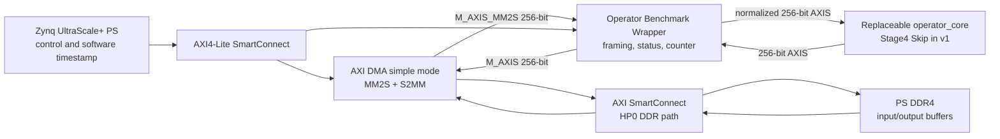

# ZCU104 可替换算子 DMA micro-benchmark 平台 v1

## 0. 状态与边界

本分支从 `codex/zcu104-full-campaign-v1` 的提交
`c67c3af7403bf40c73eb89f8e296c1112ad0dedf` 建立。它不修改 fixed 4-Stage
搜索空间，不训练 CNN，不实现 DMDC/CFEM，也不修改已有 7 个算子的数学语义。

截至本记录，7 个既有算子的接口审计、统一合同、Stage4 Skip core、RTL wrapper、
寄存器 ABI、DMA buffer 协议、HLS C-sim、非目标器件的可综合性预检、wrapper
行为仿真，以及 AXI DMA + wrapper + 实际导出的 Skip HLS IP 的器件无关 BD 连线校验已经完成。ZCU104 目标 HLS IP export、带 PS 的 Vivado Block Design 和
implementation 未被记为完成：本机 Vivado/Vitis HLS 2023.2 未安装
`xczu7ev-ffvc1156-2-e` 器件包，既有 2022.2 远端只允许密码认证且本会话没有凭据。
不得把非目标器件预检写成 ZCU104 HLS/route 结果。

权威机器可执行：

```powershell
& '<Vitis_HLS>/bin/vitis_hls.bat' -f hardware/zcu104_dma_shell_v1/hls/skip_core/run_hls.tcl
& '<Vivado>/bin/vivado.bat' -mode batch -source hardware/zcu104_dma_shell_v1/vivado/build_bd.tcl
```

`build_bd.tcl` 只接受 ZCU104 目标 part；没有器件包时 fail-closed，不降级到其他
FPGA 做 implementation。

## 1. Benchmark platform architecture



PS 的 `M_AXI_HPM0_FPD` 访问 DMA 和 wrapper 的控制寄存器；DMA 的 MM2S/S2MM
master 经 SmartConnect 接 PS `S_AXI_HP0_FPD`。所有 PL 数据、控制和 core 使用同一
200 MHz `pl_clk0`；`pl_resetn0` 经 `proc_sys_reset` 同步生成 active-low reset。

v1 采用轮询完成方式。DMA 和 wrapper 的中断口保留但不接入 PS，直至 Linux、
PYNQ 或 bare-metal 控制方式得到确认。

## 2. 现有 7 个算子接口审计

原始报告来自 2022.2 HLS evidence tar，SHA256 为
`be2f9c697bfeee75b2ef9bf8853c72004bf6b1106ef387045606a5c66b22a521`；
逐行结果位于 `artifacts/zcu104_dma_shell_v1/operator_interface_audit.json`。

| operator_core | 输入 AXIS | 输出 AXIS | 输入/输出 words | weights / biases | 既有证据 |
|---|---:|---:|---:|---:|---|
| Stage2 K3-E3 | 128 bit | 192 bit | 12,544 / 3,136 | 2,352 B / 480 B | HLS + operator OOC route PASS |
| Stage2 K3-E6 | 128 bit | 192 bit | 12,544 / 3,136 | 4,704 B / 864 B | PASS |
| Stage2 K5-E3 | 128 bit | 192 bit | 12,544 / 3,136 | 3,120 B / 480 B | PASS |
| Stage2 K5-E6 | 128 bit | 192 bit | 12,544 / 3,136 | 6,240 B / 864 B | PASS |
| Stage4 Skip | 256 bit | 256 bit | 784 / 784 | 无有效参数 | PASS |
| Stage4 MBConv-K3-E3 | 256 bit | 256 bit | 784 / 784 | 7,008 B / 896 B | PASS |
| Stage4 MBConv-K5-E3 | 256 bit | 256 bit | 784 / 784 | 8,544 B / 896 B | PASS |

共同接口事实如下。

- activation 为 signed INT8；累加与 bias 为 signed INT32。
- flatten 顺序为 pixel-major HWC。逻辑 shape 虽写作 CHW，流上先遍历 `h`，再
  `w`，每拍把所有 channel 打包。
- channel `c` 占 `TDATA[8*c+7:8*c]`；`TKEEP/TSTRB` 对有效整拍均为全 1。
- 输入和输出都带 `TLAST`。既有 core 由固定循环长度决定运算，不依赖输入
  `TLAST`；输出只在末像素置一次 `TLAST`。
- 既有 top control 为 HLS 标准 AXI4-Lite `ap_ctrl_hs`。
- MBConv 的 weights/biases 为 BRAM master interface；Skip 的占位参数未使用，
  综合后退化为 `ap_none` 标量，而不是有效 BRAM。

这说明不应把算子强行改成旧平台的多个 `m_axi`。固定 DMA 和每个 core 之间放
adapter 才是可替换边界。

## 3. AXI interface contract

### 3.1 Shell 外部接口

| interface | 方向 | 合同 |
|---|---|---|
| `S_AXIS_DMA` | DMA MM2S → shell | 256-bit TDATA，32-bit TKEEP/TSTRB，TLAST |
| `M_AXIS_DMA` | shell → DMA S2MM | 256-bit TDATA，32-bit TKEEP/TSTRB，TLAST |
| `S_AXI_CTRL` | PS → shell | AXI4-Lite，32-bit data，8-bit local address |
| `M_AXIS_CORE` | shell → core | v1 为 256-bit；由 shell 重建 TLAST |
| `S_AXIS_CORE` | core → shell | v1 为 256-bit；由 shell检查并重建 TLAST |
| `core_ap_*` | shell ↔ core | direct `ap_start/done/idle/ready` |

wrapper 只在 BUSY 状态转发数据。它根据 expected word count 重新生成 core 输入
TLAST 和 DMA 输出 TLAST，同时检查原始 TLAST/TKEEP/TSTRB。因此 malformed 帧会
留下 error flag，而不会静默改变 DMA 帧边界。

### 3.2 参数 BRAM

Skip 不需要参数 BRAM。替换为 MBConv 时，core 的 weights 和 biases BRAM master
分别连接双口 BRAM 的 port B；PS 通过 AXI BRAM Controller 访问 port A。建议地址
窗口从 `0xA0100000`（weights）和 `0xA0200000`（biases）开始，实际 range 按对应
core 的参数字节数向 4 KiB 对齐。启动前先写完参数，再写 shell START；运行期间
不得修改 BRAM。

## 4. Register map

wrapper 基地址固定为 `0xA0000000`，窗口 64 KiB；DMA 基地址固定为
`0xA0010000`，窗口 64 KiB。

| offset | register | access | definition |
|---:|---|---|---|
| `0x00` | CONTROL | W1P | bit0 START；bit1 CLEAR_DONE；bit2 CLEAR_ERRORS |
| `0x04` | STATUS | RO | bit0 IDLE；1 BUSY；2 DONE；3 ERROR；4 CORE_IDLE；5 CORE_READY；6 CORE_DONE_SEEN；7 INPUT_STARTED；8 OUTPUT_STARTED |
| `0x08/0x0C` | EXECUTION_COUNT LO/HI | RO | 成功接收末输出拍后加一 |
| `0x10/0x14` | OPERATOR_CORE_LATENCY_CYCLES LO/HI | RO | 最近一次完成事务的 core 握手区间 |
| `0x18` | EXPECTED_INPUT_WORDS | RO | 当前 core 合同输入拍数 |
| `0x1C` | EXPECTED_OUTPUT_WORDS | RO | 当前 core 合同输出拍数 |
| `0x20` | INPUT_WORDS_SEEN | RO | 当前/最近事务已接收输入拍数 |
| `0x24` | OUTPUT_WORDS_SEEN | RO | 当前/最近事务已发送输出拍数 |
| `0x28` | ERROR_FLAGS | RO | start/busy、TLAST、TKEEP、TSTRB 错误 |
| `0x2C` | SHELL_ID | RO | `0x444D4153` (`DMAS`) |
| `0x30` | VERSION | RO | `0x00010000` |
| `0x34` | OPERATOR_ID | RO | Stage4 Skip 为 `0x00040001` |
| `0x38` | AXIS_DATA_BITS | RO | 256 |
| `0x3C` | CLOCK_HZ | RO | 200,000,000 |

64-bit counter 用 high-low-high 重读方式读取。CONTROL 的三个命令均为 write-one
pulse；START while BUSY 不重启 core，只置 ERROR_FLAGS bit0。

## 5. DMA buffer protocol

Stage4 Skip 的输入/输出 buffer 均为 25,088 bytes：

```text
byte_offset(h,w,c) = ((h * 28 + w) * 32 + c)
0 <= h,w < 28, 0 <= c < 32
```

每个 256-bit DMA word 对应一个像素的 32 个 channel；channel 0 是最低地址字节，
也是 `TDATA[7:0]`。MM2S 和 S2MM 的 BTT 均为 25,088 bytes，共 784 拍；TLAST 在
word index 783。buffer 至少 64-byte 对齐，PS 必须显式 flush input cache 并
invalidate output cache。

Stage2 的固定外部协议仍为 256-bit byte stream：输入 200,704 bytes / 6,272 DMA
拍，输出 75,264 bytes / 2,352 DMA 拍。adapter 把输入 256→128 bit，把输出
192→256 bit；输出以连续 byte stream 重打包，4 个 192-bit pixel words 恰好形成
3 个 256-bit DMA words。DMA transfer length 始终是有效 payload bytes，不用
padding 长度替代。

## 6. Cycle-counter definition

`operator_core_latency_cycles` 是一个 inclusive cycle count：

1. 在 `M_AXIS_CORE.TVALID && TREADY` 首次成立的时钟沿置为 1；
2. 从此每个 PL 时钟加一，包括 core 内部停顿和输出 backpressure；
3. 在最后一个 `S_AXIS_CORE` 输出拍被 shell 接收的时钟沿锁存并停止。

它不含 START 到首输入拍之间的 DMA 启动时间，也不含末输出拍之后的 DMA/PS
完成处理。200 MHz 下换算为 `cycles / 200e6` 秒。

`PS/DMA end-to-end latency` 必须由 PS 软件单独计时：从准备 S2MM、shell 和
MM2S 之前开始，到两个 DMA channel 完成且 shell DONE 后结束。该值只能进入未来
board-run record 的独立字段，不得写入或重命名为 core cycles。

## 7. Operator wrapper implementation

`hardware/zcu104_dma_shell_v1/rtl/operator_benchmark_wrapper.v` 实现：

- 完整、可独立握手的 AXI4-Lite AW/W/B 与 AR/R channel；
- DMA/core AXIS gating、TLAST 归一化与 TKEEP/TSTRB 检查；
- `start/done/execution_count/status`；
- 首 core 输入握手到末 core 输出握手的 64-bit counter；
- direct `ap_ctrl_hs` core 控制，不需要第二个软件可见 AXI-Lite bank。

Stage4 Skip core 位于
`hardware/zcu104_dma_shell_v1/hls/skip_core/zcu104_stage4_skip_core.cpp`。它是原
Skip 固定 28×28×32 pixel-major identity loop 的 interface-only 变体：移除无用
参数端口并把 control 暴露为 direct `ap_ctrl_hs`，数学数据路径仍逐拍恒等。

## 8. Vivado Block Design and implementation gate

`hardware/zcu104_dma_shell_v1/vivado/build_bd.tcl` 定义并自动构建：

- ZCU104 `zynq_ultra_ps_e`；
- AXI DMA simple mode，256-bit stream，26-bit BTT；
- AXI DMA MM2S/S2MM memory-map master 均为 256 bit；由 memory SmartConnect 适配 PS HP0 宽度；
- control SmartConnect（PS HPM0 → wrapper + DMA）；
- memory SmartConnect（DMA MM2S/S2MM → PS HP0）；
- `proc_sys_reset`、200 MHz shared PL clock；
- packaged wrapper IP 和 exported HLS Skip core；
- 固定地址映射、BD validation、synthesis、implementation、bitstream、routed DCP、
  timing/utilization reports 和 XSA。

本机环境审计为 `ZCU104_TARGET_MATCHES=0`、`ZCU104_BOARD_MATCHES=0`。所以当前不得
生成 `build_result.json=PASS`。目标器件包或已有 2022.2 远端认证可用后，必须让
脚本跑到 `write_bitstream Complete!`，再根据 post-route timing 确认 WNS≥0。

## 9. First operator validation and replacement procedure

当前 Stage4 Skip 验证层次必须分开：

| evidence layer | result |
|---|---|
| 既有 ZCU104 2022.2 Skip HLS | PASS，787 cycles，256-bit AXIS |
| 既有 ZCU104 operator-only OOC route | PASS，WNS +2.412 ns；不是 DMA shell route |
| 新 direct-control Skip HLS C-sim | PASS，784 words，bit-exact，单末 TLAST |
| 新 wrapper XSim | PASS，784-word transaction，register/TLAST 检查，模型链路 785 cycles |
| 新 direct-control core 的非 ZCU104 export | PASS_PRECHECK_ONLY；不得作为目标 IP 证据 |
| 新 wrapper + 实际导出 Skip RTL XSim | PASS_PRECHECK_ONLY；784-word bit-exact，单末拍 TLAST，core counter 787 cycles |
| 新 AXI DMA + wrapper + 实际 Skip IP 的 BD 连线校验 | PASS_PRECHECK_ONLY；256-bit AXIS 接口兼容，不含 PS/目标综合/实现 |
| ZCU104 HLS IP export + full DMA implementation | BLOCKED_ENVIRONMENT；不是 PASS |
| PS/DMA board run | NOT_RUN |
| board power | NOT_MEASURED |

替换其余 8 个 operator_core 的方法如下，完成任一替换后都重新跑 HLS、BD validation
和 full implementation；本分支当前不执行这些替换。

1. Stage4 MBConv-K3-E3 / K5-E3：保持 256-bit shell，无需 gearbox；导出 direct
   `ap_ctrl_hs` core，加入双口 weights/bias BRAM，按审计字节数加载参数。
2. 四个 Stage2 MBConv：保持 DMA 256-bit，启用 256→128 输入 gearbox 和
   192→256 输出 gearbox；expected count 使用 DMA 拍数，core counter 的起止仍取
   gearbox 后 core handshake；加入对应参数 BRAM。
3. 每次替换更新 `OPERATOR_ID`、输入/输出 bytes、word count、BRAM range 和参数
   SHA256；不改变 `0x00–0x3C` 寄存器 ABI 或 DMA/PS 地址。
4. 对输入/输出做 C-sim 或 RTL byte-exact parity，必须验证 HWC flatten、signed
   INT8 byte lane、全字节 TKEEP/TSTRB 和唯一末 TLAST。
5. DMDC 和 CFEM 是“其他 8 个”中的两个保留 slot，但现阶段仍缺 exact INT8/HLS
   semantics。只有语义、权重导出和 parity 独立通过后才可进入上述流程；本分支不
   实现也不代填它们。

本平台的完成边界是单算子 DMA shell 的 HLS/BD/full implementation。即使该边界
关闭，也必须停止，不开始 9 个算子的正式板级 latency 或 power 测量。
