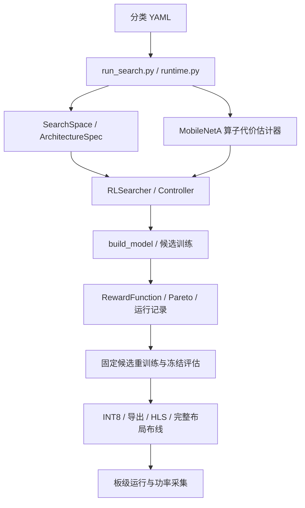

# 方法实现架构与调用路径

核对日期：2026-09-09。方法定义见[method_design](method_design.md)，参数版本见[配置索引](SEARCH_CONFIG_CANONICAL.md)。本页只维护代码对应关系，减少多份方法描述相互覆盖。

箭头表示软件调用或后续产物流向，不表示所有环节已经运行或通过。

| 模块 | 实现位置 | 保留原因 |
|---|---|---|
| 分类入口与装配 | [run_search.py](../run_search.py)、[runtime.py](../src/hwnas_fpga/runtime.py) | 读取配置、创建空间和代价模型、选择搜索器 |
| 架构表示和合法性 | [search_space/space.py](../src/hwnas_fpga/search_space/space.py) | 架构编码、阶段约束和基线构造 |
| RL 与共享逻辑 | [rl_searcher.py](../src/hwnas_fpga/search/rl_searcher.py)、[searcher.py](../src/hwnas_fpga/search/searcher.py) | 控制器、奖励、候选评估和搜索状态 |
| 多目标和效率 | [pareto.py](../src/hwnas_fpga/search/pareto.py)、[efficiency.py](../src/hwnas_fpga/search/efficiency.py) | 非支配关系与实际计算成本记录 |
| 网络与算子 | [builder.py](../src/hwnas_fpga/models/builder.py) | MBConv、DMDC、CFEM 与网络装配 |
| 分类数据与训练 | [data](../src/hwnas_fpga/data)、[training](../src/hwnas_fpga/training) | 划分、训练配方、指标与模型选择 |
| ZCU104 分类代价 | [mobilenetA_operator_cost.py](../src/hwnas_fpga/hardware/mobilenetA_operator_cost.py) | 88 行表绑定、查询和聚合；保留其他硬件模块供历史版本使用 |
| 运行证据 | [experiment.py](../src/hwnas_fpga/experiment.py)、[experiment_contract.py](../src/hwnas_fpga/experiment_contract.py)、[research_gates.py](../src/hwnas_fpga/research_gates.py) | 配置、候选身份、来源和证据准入 |
| 固定候选评估 | [run_retrain.py](../run_retrain.py)、[run_eval_protocol.py](../run_eval_protocol.py) | 与搜索过程分开的训练/评估入口 |
| 导出与数值验证 | [run_export.py](../run_export.py)、[deploy](../src/hwnas_fpga/deploy) | 量化、权重、导出和一致性检查 |
| 硬件实现 | [hls_lut_builder](../hls_lut_builder)、[zcu104_dma_shell_v1](../hardware/zcu104_dma_shell_v1) | HLS 模板、RTL、DMA 和软件接口；不能整目录当作缓存 |
| 板级证据 | [run_dynamic_validation.py](../hls_lut_builder/board_harness/scripts/run_dynamic_validation.py)、[capture_zcu104_onboard_power.py](../scripts/capture_zcu104_onboard_power.py) | 不同板卡入口须按实际部署绑定使用 |

## 独立检测路径

[run_detection_experiment.py](../scripts/run_detection_experiment.py) → `baseline_architecture()` → [build_detection_model](../src/hwnas_fpga/models/detection.py) → [detection_trainer](../src/hwnas_fpga/training/detection_trainer.py) / [detection_metrics](../src/hwnas_fpga/training/detection_metrics.py)。数据由 [data/detection.py](../src/hwnas_fpga/data/detection.py) 读取，硬件补充表由 [detection_cost.py](../src/hwnas_fpga/hardware/detection_cost.py) 处理。

该入口目前是固定骨干基线的训练与评估。共享搜索空间定义并不代表已接通 RL 搜索；分类与检测的输入尺寸、标签、输出头和指标分别保留。

## 整理边界

现有 Random、Aging、Proxyless、SPOS 和历史硬件实现仍被历史配置/测试使用。方法冲突通过明确版本与入口解决，不能仅因当前不用而删除共享实现。完整保留路径和清理批次见[文件整理入口](FILE_CLEANUP_PLAN.md)。
